# Sex-Chromosome Dosage Analysis in the Horse (*Equus caballus*)

**Student Name:** Klea Mae G. Estrellanes  
**Student Number:** 202400728  
**Course:** Cell and Molecular Biology  
**Section:** B  

---

# 1. PROJECT OVERVIEW

## 1.1 Background

Sex-chromosome dosage analysis uses differences in sequencing depth between sex chromosomes and autosomes to estimate the possible sex-chromosome complement of a biological sample.

In typical diploid mammals with an XX/XY sex-determination system:

- XX individuals generally have an X-to-autosome sequencing-depth ratio (X:A) near 1.0.
- XY individuals generally have an X:A ratio near 0.5, particularly when analysis focuses on non-pseudoautosomal regions.

This project investigates sex-chromosome dosage in the horse (*Equus caballus*) using whole-genome sequencing (WGS) data, a chromosome-level reference genome, the Galaxy bioinformatics platform, and R statistical analysis.

The primary objective is to calculate the relative sequencing depth of the X chromosome compared with the autosomes and determine whether the observed pattern is consistent with an XX-like or XY-like chromosome complement.

## 1.2 Research Objectives

1. Identify a suitable animal species with an established diploid XX/XY sex-determination system.
2. Retrieve a chromosome-level reference genome and WGS data from NCBI.
3. Assess the quality of paired-end sequencing reads using FastQC and MultiQC.
4. Align sequencing reads to the selected reference genome using BWA-MEM2.
5. Obtain chromosome-level sequencing coverage using Samtools Coverage.
6. Calculate relative chromosome sequencing depth and the X:A ratio using R.
7. Compare the inferred chromosome dosage pattern with the recorded sex of the WGS BioSample.
8. Document the bioinformatics workflow, data, results, and limitations.

**Selected species:** *Equus caballus*  
**Common name:** Horse  
**Sex-determination system:** XX/XY  
**Analysis type:** Whole-genome sequencing read-depth analysis  
**Bioinformatics platforms:** NCBI, Galaxy, and RStudio  

---

# 2. SPECIES AND REFERENCE GENOME

## 2.1 Species Identification

The selected species is the domestic horse (*Equus caballus*).

The horse has a normal diploid chromosome number of 2n = 64, with a typical female chromosome complement of 64,XX and a typical male complement of 64,XY.

The species therefore has an established XX/XY sex-determination system and is appropriate for X-to-autosome sequencing-depth analysis.

## 2.2 Reference Genome Information

The reference genome was obtained from the National Center for Biotechnology Information (NCBI).

| Parameter | Information |
|---|---|
| Organism | *Equus caballus* |
| Assembly name | EquCab3.0 |
| Assembly accession | GCF_002863925.1 |
| Assembly level | Chromosome-level |
| Assembly donor | Isolate Twilight |
| Reference source | NCBI |

**NCBI Assembly:**  
https://www.ncbi.nlm.nih.gov/datasets/genome/GCF_002863925.1/

### Assembly BioSample

| Parameter | Information |
|---|---|
| Assembly BioSample | SAMN02953672 |
| Assembly donor | Isolate Twilight |

**Assembly BioSample record:**  
https://www.ncbi.nlm.nih.gov/biosample/SAMN02953672

## 2.3 Chromosome Identification and Selection

The chromosome accessions were identified using the EquCab3.0 chromosome-level reference assembly information.

The analysis included 31 autosomes and one X chromosome.

| Chromosome category | Reference accession |
|---|---|
| Autosomes | NC_009144.3–NC_009174.3 |
| X chromosome | NC_009175.3 |

The chromosome grouping file classifies the sequences as follows:

- **A:** Autosomes
- **X:** X chromosome

Mitochondrial DNA, unplaced scaffolds, and sequences not identified as the selected chromosomes were excluded from the chromosome dosage analysis.

The reference assembly does not contain an annotated Y chromosome sequence available for this analysis. Consequently, a Y-to-autosome (Y:A) sequencing-depth ratio could not be calculated.

---

# 3. WHOLE-GENOME SEQUENCING DATA

## 3.1 WGS Sample Information

The WGS reads were obtained from the NCBI Sequence Read Archive (SRA).

| Parameter | Information |
|---|---|
| Organism | *Equus caballus* |
| Sample name | WB03 |
| WGS BioSample | SAMN37129746 |
| SRA experiment | SRX21474078 |
| SRA run | SRR25750664 |
| BioProject | PRJNA1005486 |
| Tissue | Blood |
| Recorded sex | Female |
| Sequencing platform | Illumina NovaSeq 6000 |
| Sequencing strategy | Whole-genome shotgun sequencing |
| Library layout | Paired-end |
| Read length | 150 bp |

**NCBI SRA Run:**  
https://www.ncbi.nlm.nih.gov/sra/SRR25750664

**WGS BioSample:**  
https://www.ncbi.nlm.nih.gov/biosample/SAMN37129746

**BioProject:**  
https://www.ncbi.nlm.nih.gov/bioproject/PRJNA1005486

## 3.2 Assembly Donor and WGS Donor Comparison

The reference assembly donor and WGS sample are represented by separate BioSample records.

| Information | Reference assembly | WGS sample |
|---|---|---|
| Sample identity | Isolate Twilight | WB03 |
| BioSample | SAMN02953672 | SAMN37129746 |
| Organism | *Equus caballus* | *Equus caballus* |
| Recorded sex | Female assembly donor metadata | Female |
| Same donor? | No; separate sample records | No; separate sample records |

The reference assembly and WGS reads must not be assumed to originate from the same individual.

The chromosome dosage inference in this investigation applies to the WGS sample WB03. Its inferred result is compared with the sex recorded in its own NCBI BioSample record.

---

# 4. GALAXY HISTORY AND BIOINFORMATICS WORKFLOW

## 4.1 Galaxy History

The bioinformatics workflow was performed using the Galaxy platform.

**Galaxy platform:**  
https://usegalaxy.org/

**Galaxy History Name:** `Sex_Dosage_Horse`

**Shareable Galaxy History Link:**  
https://usegalaxy.org/u/estrellanes_08/h/sex-dosage-horse

The Galaxy history contains the reference genome, paired-end sequencing reads, quality-control outputs, alignment results, alignment statistics, and chromosome coverage results.

## 4.2 Data Acquisition

The EquCab3.0 reference genome was obtained from NCBI using assembly accession GCF_002863925.1.

The paired-end WGS reads were obtained using SRA run accession SRR25750664.

The reference FASTA and sequencing reads were imported into Galaxy for subsequent analysis.

## 4.3 Sequence Quality Assessment: FastQC

FastQC was used to evaluate the quality of the forward and reverse sequencing reads.

The quality assessment included:

- Per-base sequence quality
- Per-sequence quality scores
- Per-base sequence composition
- Per-sequence GC content
- Sequence duplication levels
- Adapter content
- Sequence length distribution

The individual FastQC reports are provided in the evidence directory.

## 4.4 MultiQC Summary

MultiQC was used to consolidate the quality-control results from the forward and reverse reads.

The MultiQC statistics showed:

| Quality metric | Forward reads | Reverse reads |
|---|---:|---:|
| Total sequences | 92,313,702 | 92,313,702 |
| Mean sequence length | 150 bp | 150 bp |
| Median sequence length | 150 bp | 150 bp |
| GC content | 42% | 42% |
| Duplicate reads | 16.49% | 15.69% |
| Failed FastQC modules | 0 | 0 |

No FastQC modules were reported as failed in the MultiQC statistics.

The individual FastQC reports and selected MultiQC plots are included in the `evidence/` directory.

## 4.5 Read Alignment: BWA-MEM2

The paired-end sequencing reads were aligned against the EquCab3.0 reference genome using BWA-MEM2 in Galaxy.

The alignment was performed using the same reference genome used for the chromosome coverage analysis.

The resulting BAM alignment output was used for downstream alignment statistics and chromosome-level coverage analysis.

The Galaxy history provides the corresponding alignment output and job information.

**BAM processing:** Coordinate sorting and indexing must be confirmed from the Galaxy history before being reported as completed. The alignment output alone does not establish that both operations were performed.

## 4.6 Alignment Statistics: Samtools Flagstat

Samtools Flagstat was used to summarize the alignment statistics.

| Alignment metric | Result |
|---|---:|
| Total reads | 184,965,240 |
| Primary reads | 184,627,404 |
| Mapped reads | 184,670,143 |
| Mapping rate | 99.84% |
| Properly paired reads | 181,356,252 |
| Properly paired percentage | 98.23% |
| Singletons | 136,543 |
| Duplicate reads marked by Flagstat | 0 |

The high mapping rate indicates that most sequencing reads aligned to the selected reference genome.

The zero duplicate count reported by Flagstat indicates that no reads were marked as duplicates in the alignment file. It does not establish that the original sequencing library contained no PCR duplicates.

## 4.7 Chromosome Coverage: Samtools Coverage

Samtools Coverage was used to obtain chromosome-level sequencing depth information.

The resulting tabular coverage output was downloaded and saved as:

`chromosome_coverage.tsv`

The coverage table contains the chromosome identifiers and mean sequencing depth required for the downstream R analysis.

The chromosome grouping file was prepared and saved as:

`chromosome_groups.csv`

The grouping file uses the exact chromosome reference identifiers from the coverage data.

**Coverage parameter verification:** The laboratory instructions specify a minimum mapping quality of 20 and a minimum base quality of 20 where supported. These settings must be checked against the actual Samtools Coverage Galaxy job configuration before being reported as confirmed experimental parameters.

---

# 5. CHROMOSOME GROUPING AND INPUT DATA

## 5.1 Chromosome Grouping File

The file `chromosome_groups.csv` contains the chromosome identifiers and their assigned categories.

The required column headers are:

`rname,group`

The chromosome categories used are:

| Group | Meaning |
|---|---|
| A | Autosomes |
| X | X chromosome |

The grouping file contains 31 autosomes and one X chromosome, for a total of 32 chromosome entries.

The mitochondrial sequence and unplaced scaffolds were excluded.

## 5.2 Coverage Input File

The file `chromosome_coverage.tsv` contains the chromosome-level coverage data generated by Samtools Coverage.

The R analysis uses the `rname` and `meandepth` columns to calculate relative sequencing depth.

The coverage file is retained in the root directory of the GitHub repository to provide the input data required for reproducibility.

---

# 6. R ANALYSIS

## 6.1 Analysis Method

RStudio was used to calculate chromosome-relative sequencing depth and infer the possible sex-chromosome dosage pattern.

The analysis uses the median autosomal sequencing depth as the reference value.

The relative depth of each chromosome is calculated as:

Relative depth = Chromosome mean depth / Median autosomal depth

The X:A ratio is obtained by comparing the X chromosome relative depth with the autosomal reference depth.

The classroom interpretation guidelines are:

| X:A ratio | Interpretation |
|---|---|
| Near 1.0 | XX-like |
| Near 0.5 | XY-like |
| 0.65–0.80 | Ambiguous |

These are teaching guidelines rather than diagnostic thresholds.

## 6.2 Complete R Script

The following is the analysis script specified in the laboratory instructions.

```r
# Sex-chromosome dosage from whole-genome DNA read depth
# Input: Samtools coverage TSV + student chromosome labels

cov <- read.delim("chromosome_coverage.tsv", comment.char = "",
                  check.names = FALSE, stringsAsFactors = FALSE)

names(cov)[1] <- "rname" # Accepts the '#rname' header

if (!"meandepth" %in% names(cov))
  stop("Missing meandepth column")

key <- read.csv("chromosome_groups.csv",
                stringsAsFactors = FALSE)

if (!all(c("rname", "group") %in% names(key)))
  stop("Bad key columns")

key$rname <- trimws(key$rname)
key$group <- toupper(trimws(key$group))

if (anyDuplicated(key$rname))
  stop("Repeated rname in key file")

if (!all(key$group %in% c("A", "X", "Y", "Z", "W")))
  stop("Use only A, X, Y, Z or W in the group column")

x <- merge(key, cov[, c("rname", "meandepth")],
           by = "rname", all.x = TRUE, sort = FALSE)

x$meandepth <- suppressWarnings(as.numeric(x$meandepth))

if (anyNA(x$meandepth))
  stop("Missing depths: check rname matches")

if (any(x$meandepth < 0))
  stop("Negative depth is not valid")

if (sum(x$group == "A") < 5)
  stop("Label at least 5 autosomes")

if ("X" %in% x$group && "Z" %in% x$group)
  stop("Choose either an XY or a ZW species, not both")

if (sum(x$group == "X") == 1 && !any(x$group == "Z")) {
  target <- "X"
  one_copy <- "XY-like"
  two_copies <- "XX-like"

} else if (sum(x$group == "Z") == 1 && !any(x$group == "X")) {
  target <- "Z"
  one_copy <- "ZW-like"
  two_copies <- "ZZ-like"

} else {
  stop("Label exactly one X or exactly one Z chromosome")
}

A <- median(x$meandepth[x$group == "A"])

if (!is.finite(A) || A <= 0)
  stop("No usable autosomal coverage")

x$relative_depth <- x$meandepth / A

ratio <- x$relative_depth[x$group == target]

call <- if (ratio >= 0.80) {
  two_copies
} else if (ratio <= 0.65) {
  one_copy
} else {
  "Ambiguous"
}

if (A < 1)
  call <- "Inconclusive: very low autosomal depth"

# Additional Y or W evidence can support, but not prove, a call

partner <- if (target == "X") "Y" else "W"

partner_ratio <- if (partner %in% x$group) {
  x$relative_depth[x$group == partner][1]
} else {
  NA_real_
}

# Export results and a simple, reproducible figure

dir.create("results", showWarnings = FALSE)

write.csv(x, "results/chromosome_relative_depth.csv",
          row.names = FALSE)

png("results/chromosome_depth.png",
    width = 1000, height = 580)

par(mar = c(8, 4, 3, 1))

barplot(x$relative_depth,
        names.arg = x$rname,
        las = 2,
        ylab = "Depth relative to median autosome",
        main = "Autosomal and sex-chromosome depth",
        cex.names = 0.75)

abline(h = c(0.5, 1.0), lty = 2)

dev.off()

summary <- c(
  paste("Median autosome depth:", round(A, 3)),
  paste(target, "/ A ratio:", round(ratio, 3)),
  paste(partner, "/ A ratio:", round(partner_ratio, 3)),
  paste("Dosage interpretation:", call),
  "Compare with BioSample sex and discuss limitations."
)

writeLines(summary, "results/sex_inference.txt")

cat(paste(summary, collapse = "\n"), "\n")
```

## 6.3 Generated R Outputs

The R script generates three main analytical outputs:

| Output file | Description |
|---|---|
| `chromosome_relative_depth.csv` | Relative sequencing depth for each selected chromosome |
| `chromosome_depth.png` | Bar graph of chromosome-relative sequencing depth |
| `sex_inference.txt` | Text summary of the calculated depth ratios and interpretation |

All three outputs are stored in the `results/` directory.

---

# 7. RESULTS AND INTERPRETATION

## 7.1 Chromosome Sequencing-Depth Results

The R analysis produced the following measurements:

| Measurement | Result |
|---|---:|
| Median autosomal sequencing depth | 9.673× |
| X chromosome mean depth | 9.426× |
| X:A ratio | 0.974 |
| Y:A ratio | NA |
| Dosage interpretation | XX-like |

The X:A ratio was calculated by comparing the X chromosome sequencing depth with the median autosomal sequencing depth.

An X:A ratio of 0.974 indicates that the X chromosome has approximately 97.4% of the median autosomal sequencing depth.

This value is close to 1.0 and is consistent with an XX-like chromosome dosage pattern.

The Y:A ratio was recorded as NA because the selected reference assembly does not contain an annotated Y chromosome sequence available for this calculation.

## 7.2 Chromosome Relative-Depth Visualization

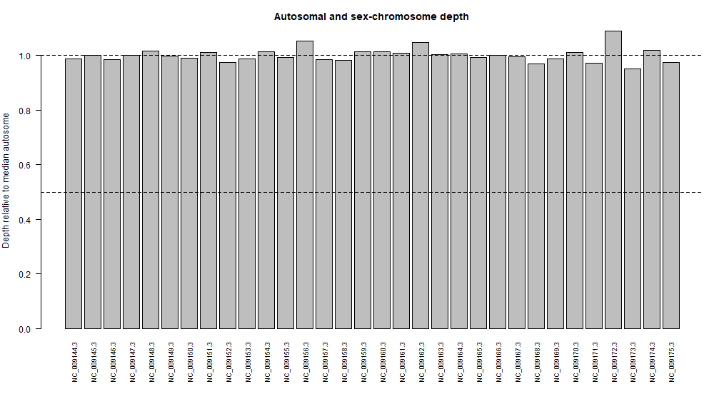

**Figure 1. Chromosome relative sequencing depth of *Equus caballus*.**

The figure presents the relative sequencing depth of the 31 autosomes and X chromosome. The median autosomal depth provides the normalization reference. The X chromosome exhibits a relative depth close to 1.0, consistent with an XX-like dosage pattern.

The absence of an annotated Y chromosome in the selected reference assembly prevents direct Y-chromosome depth comparison.

## 7.3 Scientific Interpretation

The observed X:A ratio of 0.974 supports an XX-like dosage pattern in the analyzed WGS sample.

This interpretation agrees with the NCBI BioSample metadata for WB03, which records the sample as female.

However, read-depth analysis provides an indirect estimate of chromosome dosage. It is not equivalent to cytogenetic karyotyping or direct confirmation of an individual's complete chromosome complement.

The result should therefore be interpreted as an XX-like sequencing-depth pattern rather than definitive proof of a complete 64,XX karyotype.

---

# 8. EVIDENCE GALLERY

This section documents the NCBI records, Galaxy quality-control outputs, read alignment, chromosome coverage, and R analysis used in this investigation.

All screenshots and supporting reports are stored in the `evidence/` directory. The generated analytical results are stored in `results/`.

## 8.1 NCBI Metadata Evidence

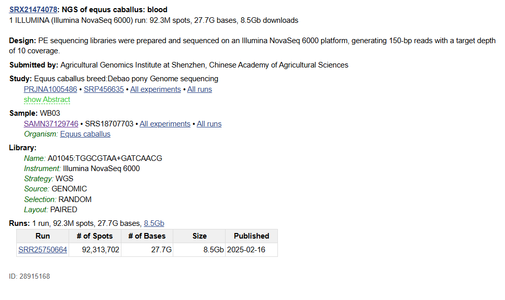

**Figure 2. NCBI SRA run metadata for SRR25750664.**

This screenshot documents the WGS sequencing run associated with *Equus caballus*. It identifies the paired-end sequencing layout, Illumina NovaSeq 6000 platform, 150-bp reads, BioSample SAMN37129746, and BioProject PRJNA1005486.

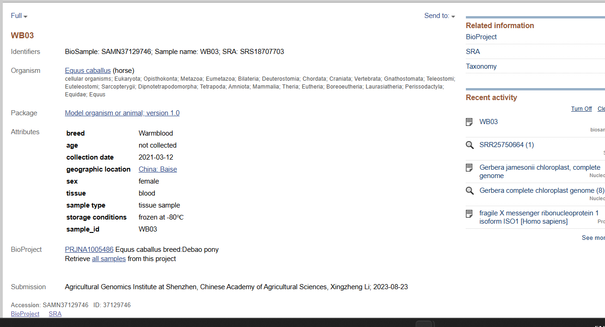

**Figure 3. NCBI BioSample metadata confirming the recorded sex of WB03.**

The BioSample record SAMN37129746 identifies WB03 as a female *Equus caballus* blood sample. This information provides an independent metadata reference for comparison with the chromosome dosage inference.

## 8.2 FastQC and MultiQC Evidence

Individual FastQC reports:

- [Forward Reads FastQC Report](evidence/Forward_FastQC-webpage.pdf)
- [Reverse Reads FastQC Report](evidence/Reverse_FastQC-webpage.pdf)

These reports document the quality assessment of the forward and reverse paired-end sequencing reads.

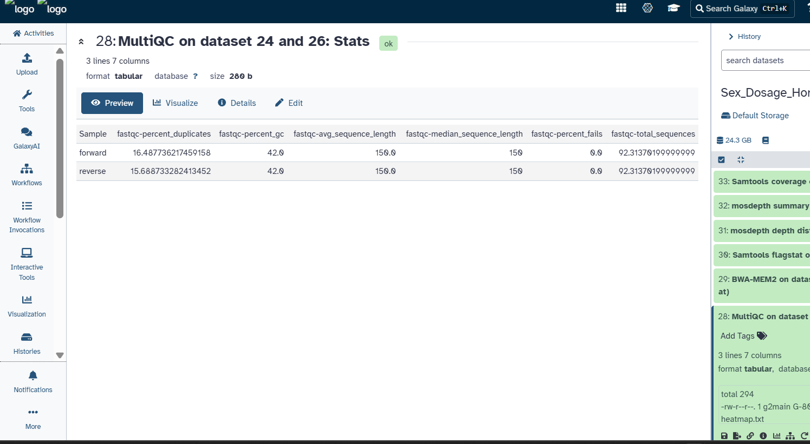

**Figure 4. MultiQC summary statistics for paired-end sequencing reads.**

The MultiQC statistics table summarizes the number of sequences, sequence lengths, GC content, duplicate-read percentages, and failed FastQC modules for both read directions.

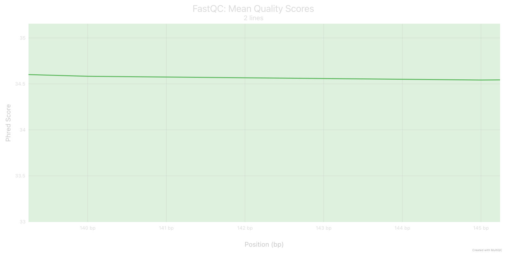

**Figure 5. MultiQC per-base sequence quality plot.**

This plot presents sequencing quality scores across individual base positions. It is used to evaluate the consistency of base-call quality throughout the sequencing reads and identify positions with potentially reduced quality.

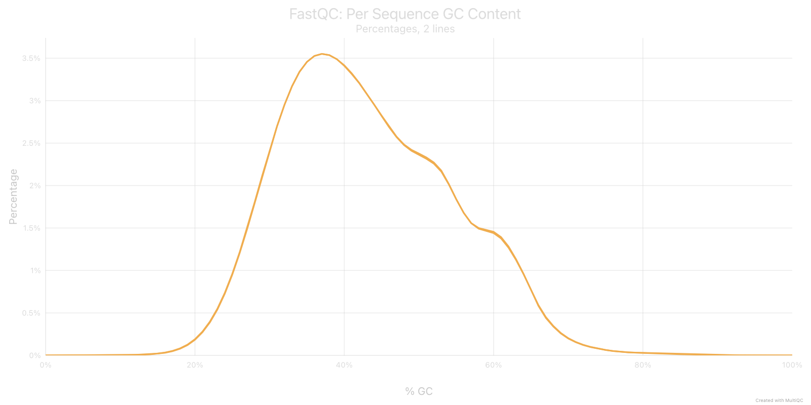

**Figure 6. MultiQC per-sequence GC content plot.**

This plot illustrates the distribution of GC content among the sequencing reads. Unusual GC-content distributions can indicate sequence-composition bias or possible contamination and should be evaluated alongside other quality-control results.

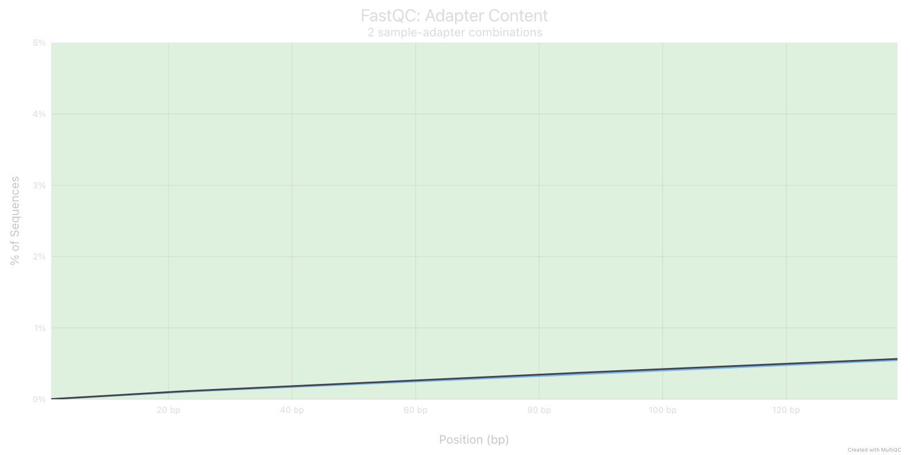

**Figure 7. MultiQC adapter content plot.**

This plot evaluates the presence of sequencing adapter sequences across the reads. Adapter contamination can affect downstream alignment and is therefore assessed during sequence quality control.

## 8.3 Galaxy Alignment and Coverage Evidence

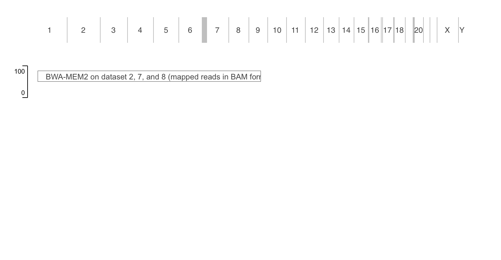

**Figure 8. BWA-MEM2 alignment output in Galaxy.**

This screenshot documents the alignment of paired-end WGS reads against the EquCab3.0 reference genome using BWA-MEM2. The alignment output was used for downstream alignment statistics and chromosome coverage analysis.

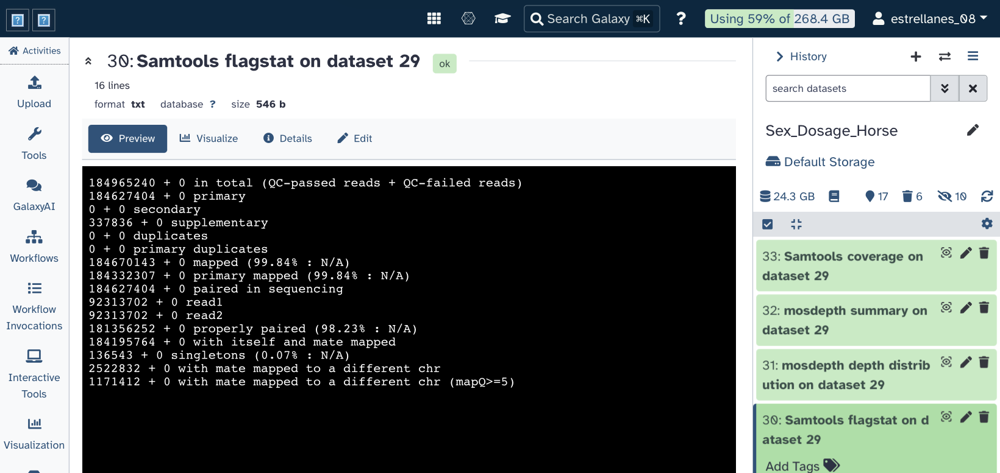

**Figure 9. Samtools Flagstat alignment statistics.**

This screenshot presents the alignment statistics, including total reads, mapped reads, mapping percentage, properly paired reads, and singletons. These measurements provide an overview of alignment performance.

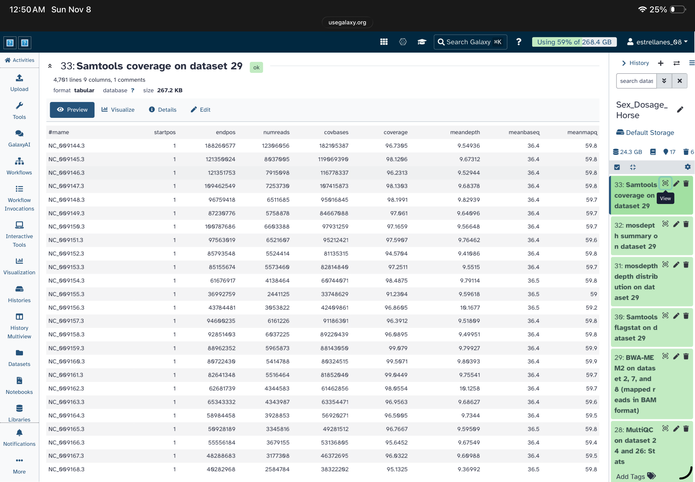

**Figure 10. Samtools Coverage chromosome-level output preview.**

This screenshot shows the chromosome-level coverage table generated by Samtools Coverage. The output contains chromosome identifiers and coverage measurements used in the subsequent R analysis.

## 8.4 R Analysis Evidence

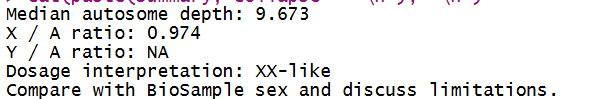

**Figure 11. RStudio console output for chromosome dosage analysis.**

The R console displays the final analytical measurements:

- Median autosome depth: 9.673
- X:A ratio: 0.974
- Y:A ratio: NA
- Dosage interpretation: XX-like

These values were generated using the chromosome coverage table and chromosome grouping file.


**Figure 12. Final chromosome relative-depth visualization generated in R.**

This graph presents the relative sequencing depth of the autosomes and X chromosome, providing a visual representation of the chromosome dosage pattern.

---

# 9. ANSWERS TO THE PRACTICAL EXAMINATION QUESTIONS

## Question 1. What species did you choose, and what evidence supports a diploid XX/XY or ZZ/ZW system?

The selected species was the horse (*Equus caballus*). Horses have a normal diploid chromosome number of 2n = 64 and an established XX/XY sex-determination system. Typical females have a 64,XX chromosome complement, while typical males have a 64,XY chromosome complement.

The NCBI chromosome-level reference assembly identifies the X chromosome, and published veterinary cytogenetic literature supports the horse's established XX/XY system.

## Question 2. What are your assembly accession, WGS run, and both BioSample accessions? Are the donors the same?

The reference assembly accession is GCF_002863925.1 (EquCab3.0).

The assembly BioSample is SAMN02953672, associated with Isolate Twilight.

The WGS run accession is SRR25750664, associated with BioSample SAMN37129746 and experiment SRX21474078.

The WGS sample is identified as WB03.

The assembly donor and WGS sample are represented by separate BioSample records. Therefore, they are treated as different individuals for this analysis.

The WGS BioSample identifies WB03 as female.

## Question 3. Which sequences were used as autosomes and as X or Z? How did you verify their identities?

The analysis used the 31 autosomal reference sequences NC_009144.3 through NC_009174.3 and the X chromosome sequence NC_009175.3.

These chromosome accessions were identified using the chromosome-level EquCab3.0 reference assembly information from NCBI.

Mitochondrial DNA and unplaced scaffolds were excluded to prevent non-nuclear or unassigned sequences from affecting the chromosome dosage analysis.

## Question 4. What are the median autosomal depth, X:A or Z:A ratio, and inferred sex-chromosome complement?

The median autosomal sequencing depth was 9.673×, and the calculated X:A ratio was 0.974.

An X:A ratio close to 1.0 is consistent with two X chromosome copies relative to the autosomes in a typical diploid XX individual.

Therefore, the observed sequencing-depth pattern supports an XX-like chromosome dosage interpretation.

The Y:A ratio could not be calculated because the selected reference assembly does not contain an annotated Y chromosome sequence available for the analysis.

## Question 5. Does your result agree with the recorded sex of the WGS donor, if reported? Explain any discrepancy or uncertainty.

Yes. The inferred XX-like dosage pattern agrees with the NCBI BioSample metadata, which identifies WB03 as female.

The agreement between the computational inference and the recorded sample metadata provides supporting evidence for the interpretation.

Nevertheless, the result is based on sequencing depth rather than direct cytogenetic examination. The reference assembly and WGS sample are separate biological records, so the assembly donor's metadata must not be substituted for the WGS donor's metadata.

## Question 6. Why is a chromosome-level assembly alone insufficient for a reliable read-depth sex inference?

A chromosome-level reference assembly provides the genomic sequences needed for read alignment, but it does not independently establish the sex-chromosome complement of a sequenced individual.

Read-depth analysis requires sequencing reads from the biological sample to estimate chromosome-specific coverage.

Furthermore, reference assemblies may lack sex-chromosome sequences, contain incomplete or misassembled regions, or represent a different individual from the WGS sample.

In this project, the absence of an annotated Y chromosome in the selected reference assembly prevented calculation of a Y:A ratio. Therefore, the XX-like inference was based primarily on the X:A ratio and compared with the independent WGS BioSample sex metadata.

---

# 10. LIMITATIONS

Several biological and technical factors may influence the accuracy of chromosome dosage inference.

1. **Reference assembly limitations:** The selected reference assembly does not contain an annotated Y chromosome sequence, preventing direct Y:A depth comparison.

2. **Sequencing depth:** Lower sequencing coverage can increase variability in chromosome-specific depth estimates.

3. **Mapping bias:** Sequence differences between the reference genome and the sequenced individual can affect read alignment and coverage.

4. **Repetitive sequences:** Repetitive genomic regions may cause ambiguous read mapping and influence coverage estimates.

5. **Pseudoautosomal regions:** Shared regions between the X and Y chromosomes may complicate sex-chromosome depth interpretation.

6. **Chromosomal abnormalities:** Aneuploidy, mosaicism, structural variation, and atypical karyotypes may produce patterns that differ from typical XX or XY complements.

7. **Indirect inference:** Sequencing-depth ratios estimate relative genomic representation and cannot replace direct cytogenetic karyotyping.

8. **Different biological donors:** The reference assembly and WGS sample represent separate BioSample records. Reference-related variation may therefore influence read mapping.

9. **Missing Y chromosome sequence:** The absence of a Y chromosome entry in the reference assembly must not be interpreted as proof that the sequenced individual lacks a Y chromosome.

The calculated X:A ratio should therefore be interpreted as evidence consistent with an XX-like dosage pattern, not as definitive karyotypic confirmation.

---

# 11. REPOSITORY STRUCTURE

The GitHub repository is organized as follows:

```text
horse-sex-chromosome-dosage-analysis/
│
├── evidence/
│   ├── Adapter_Content.png
│   ├── BWA_Alignment.png
│   ├── Forward_FastQC-webpage.pdf
│   ├── MultiQC_Statistics.png
│   ├── NCBI_BioSample_Sex_Verification.png
│   ├── NCBI_SRA_Run_Metadata.png
│   ├── Per_Base_Sequence_Quality.png
│   ├── Per_Sequence_GC_Content.png
│   ├── R_Analysis_Console.png
│   ├── Reverse_FastQC-webpage.pdf
│   ├── Samtools_Coverage_Preview.PNG
│   └── Samtools_Flagstat.png
│
├── results/
│   ├── chromosome_depth.png
│   ├── chromosome_relative_depth.csv
│   └── sex_inference.txt
│
├── chromosome_coverage.tsv
├── chromosome_groups.csv
├── sex_depth_analysis.R
└── README.md
```

Large raw sequencing and alignment files, including FASTQ, FASTA, BAM, and CRAM files, are not included in the public repository.

---

# 12. REFERENCES AND DATA SOURCES

1. National Center for Biotechnology Information (NCBI). *Equus caballus* reference genome assembly EquCab3.0. Assembly accession GCF_002863925.1.  
   https://www.ncbi.nlm.nih.gov/datasets/genome/GCF_002863925.1/

2. National Center for Biotechnology Information (NCBI). Assembly BioSample record SAMN02953672.  
   https://www.ncbi.nlm.nih.gov/biosample/SAMN02953672

3. National Center for Biotechnology Information (NCBI). Sequence Read Archive. WGS run SRR25750664.  
   https://www.ncbi.nlm.nih.gov/sra/SRR25750664

4. National Center for Biotechnology Information (NCBI). WGS BioSample record SAMN37129746.  
   https://www.ncbi.nlm.nih.gov/biosample/SAMN37129746

5. National Center for Biotechnology Information (NCBI). BioProject PRJNA1005486.  
   https://www.ncbi.nlm.nih.gov/bioproject/PRJNA1005486

6. Galaxy Project. Galaxy platform for accessible, reproducible, and collaborative biomedical analyses.  
   https://usegalaxy.org/

7. Galaxy Training Network. Introduction to Galaxy and NGS data management.  
   https://training.galaxyproject.org/training-material/topics/introduction/tutorials/galaxy-intro-ngs-data-managment/tutorial.html

8. SAMtools. Samtools Coverage Documentation.  
   https://www.htslib.org/doc/samtools-coverage.html

9. R Core Team. R: A Language and Environment for Statistical Computing.  
   https://www.r-project.org/

10. Horse Clinical Cytogenetics: Recurrent Themes and Novel Findings. Veterinary cytogenetics literature supporting the normal equine chromosome complement and sex-chromosome system.  
    https://pmc.ncbi.nlm.nih.gov/articles/PMC8001954/

11. Sex-chromosome coverage and genomic sequencing analysis review.  
    https://pmc.ncbi.nlm.nih.gov/articles/PMC6900093/

---

# 13. CONCLUSION

The chromosome read-depth analysis of *Equus caballus* produced a median autosomal sequencing depth of 9.673× and an X:A ratio of 0.974.

The observed X chromosome depth was close to the median autosomal depth, supporting an XX-like chromosome dosage pattern.

This computational inference was concordant with the female sex recorded in the WGS BioSample metadata for WB03.

Although the selected reference assembly lacked an annotated Y chromosome sequence, the X:A ratio provided evidence consistent with the expected female chromosome dosage pattern.

The analysis demonstrates how NCBI genomic resources, Galaxy-based quality assessment and read alignment, chromosome coverage analysis, and R programming can be integrated to investigate sex-chromosome dosage using whole-genome sequencing data.

The findings should be interpreted as a read-depth-based inference rather than definitive cytogenetic confirmation.

